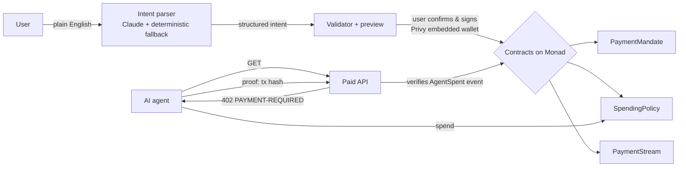

# Slappay

**Tell money what to do.**

Slappay is a programmable payments app on Monad. You describe what your money should do in plain English; Slappay turns that into a structured, previewable instruction; you sign once; a smart contract enforces it.

> "Pay Alex $500 when the website is approved."
> "Give my research agent $20 per day, max $2 per transaction."
> "Pay Sarah $20/hour until $2,000."

Built for the Monad Metropolis Hackathon, Consumer Products & Payments track. Repo: https://github.com/abhirupinspace/slappay-metropolis

## Problem

Money today is dumb. Conditional payments need an escrow agent, recurring pay needs payroll software, and giving an AI agent a budget means handing it your card. Each of these is a promise that a human has to remember, chase, or trust someone else to enforce.

## Solution

Three onchain primitives, one natural-language front door:

| Primitive | What it does | Enforced by |
|---|---|---|
| **Payment Mandate** | Lock USDC for a recipient; release on a condition (your approval, a verifier's attestation, or a timestamp). Refundable after expiry. | `PaymentMandate.sol` |
| **Spending Policy** | Escrow a budget an AI agent can spend: per-transaction cap, rolling daily cap, recipient allowlist, pause/revoke. The agent never holds your funds or keys. | `SpendingPolicy.sol` |
| **Payment Stream** | Pay per second from a fully-funded deposit until a maximum. Recipient withdraws anytime; sender can cancel and reclaim the unaccrued remainder. | `PaymentStream.sol` |

Plus **x402 for agents**: an agent hitting a paid API gets a `402`, pays through its Spending Policy, and retries with onchain proof. The policy contract, not the API, decides whether the agent may pay.

## Architecture



```
slappay/
├── contracts/          Foundry: PaymentMandate, SpendingPolicy, PaymentStream, tests, deploy scripts
├── packages/core/      chains, addresses, ABIs, USDC helpers (shared by web + agent)
├── apps/web/           Next.js 16 app: Privy auth, intent parser, preview/confirm, dashboards, x402 paid API
├── apps/agent/         Agent CLI: policy-routed payments and x402 fetch
└── scripts/local-e2e.sh  anvil -> deploy -> next dev -> agent pays a 402 end to end
```

Chain state is the source of truth. There is no database. The web app reads contract state directly from Monad every few seconds.

## Smart contracts

Solidity 0.8.28, OpenZeppelin 5.7 (`SafeERC20`, `ReentrancyGuard`). Three singleton contracts, each holding many records keyed by id. No factory, no clones, no upgradeability.

### PaymentMandate

```
create(recipient, token, amount, conditionType, verifier, releaseAfter, expiry, memo) -> id   // pulls `amount` via transferFrom
approve(id)    // MANUAL_APPROVAL: sender; ATTESTATION: verifier. Releases immediately.
release(id)    // TIME: anyone, once block.timestamp >= releaseAfter
cancel(id)     // sender after expiry, or recipient any time (decline). Refunds sender.
isReleasable(id), getMandate(id)
```

Conditions: `MANUAL_APPROVAL`, `ATTESTATION` (a designated verifier address), `TIME`. Status moves `ACTIVE -> RELEASED | CANCELLED` exactly once.

### SpendingPolicy

```
create(agent, token, txLimit, dailyLimit, recipients[], allowAnyRecipient, initialDeposit, name) -> id
fund(id, amount) / withdraw(id, amount)          // owner
setRecipient(id, addr, allowed)                  // owner
pause(id) / resume(id) / revoke(id)              // owner; revoke refunds everything and is permanent
spend(id, recipient, amount, memo)               // agent only. Reverts on any rule violation.
canSpend(id, agent, recipient, amount) -> (ok, reason)   // dry run
remainingToday(id), getPolicy(id)
```

`spend` checks, in order: caller is the agent, policy not revoked, policy active, amount > 0, amount <= txLimit, recipient allowed, spentToday + amount <= dailyLimit (day = `block.timestamp / 1 days`, UTC), amount <= escrowed balance. Only then does it transfer.

### PaymentStream

```
create(recipient, token, ratePerSecond, startTime, maxAmount, memo) -> id   // deposits maxAmount upfront
withdraw(id)   // recipient: everything accrued and not yet withdrawn
cancel(id)     // sender: pays accrued to recipient, refunds the rest
accrued(id), withdrawable(id), getStream(id)
```

`accrued = min(ratePerSecond * elapsed, maxAmount)`. Fully funded at creation, so there is no insolvency path and no liquidator.

### Tests

43 Foundry tests covering creation, happy paths, every authorization check, double-release/double-withdraw, expiry, daily-limit rollover, boundary amounts, cancellation accounting, and a fuzz test that accrual never exceeds the deposit.

```bash
cd contracts && forge test
```

## Natural-language intent

```
text -> LLM (Claude, structured JSON) -> zod schema -> validator -> preview -> user confirms -> wallet signs -> Monad
```

- `apps/web/src/lib/intent/schema.ts`: the four intent types as a zod discriminated union.
- `parser.ts`: Claude via the Anthropic SDK with `output_config.format` (structured outputs). If `ANTHROPIC_API_KEY` is missing or the call fails, it falls back to…
- `fallback.ts`: a deterministic regex parser that handles the demo phrasings offline. The demo never depends on the LLM being up.
- `validator.ts`: resolves names to addresses (the user pastes them in the preview), converts amounts to base units, derives timestamps, and returns errors instead of throwing.

The model never touches a wallet. Its only output is a JSON object that the user sees rendered as "You are about to…" before anything is signed.

## Agent security model

```
Owner (Privy wallet) --create/fund--> SpendingPolicy <--spend-- Agent (own key, holds only gas)
```

- The agent has its own key. It is never given the owner's key or a token allowance.
- USDC sits in the policy contract. The agent can only move it via `spend`, which the contract gates.
- The owner can pause, resume, withdraw, or permanently revoke at any time.
- There is no relayer. The agent submits its own transactions and pays its own gas in MON.

Frontend and CLI pre-checks (`canSpend`) are UX only. The contract is the enforcement.

## x402

`GET /api/paid/weather` is a demo paid API priced at 0.01 USDC per call. It speaks the x402 v2 envelope (`PAYMENT-REQUIRED`, `PAYMENT-SIGNATURE`, `PAYMENT-RESPONSE` headers, base64 JSON, CAIP-2 network ids) with a Slappay settlement scheme, `slappay-policy`:

1. Agent requests the resource, gets `402` with `accepts: [{scheme: "slappay-policy", network: "eip155:10143", amount, asset: USDC, payTo, extra: {spendingPolicy, memo}}]`.
2. Agent calls `SpendingPolicy.spend(policyId, payTo, amount, memo)` on Monad. The memo is the resource URL, binding the payment to the request.
3. Agent retries with `PAYMENT-SIGNATURE: {policyId, txHash}`.
4. The server reads the receipt, finds the `AgentSpent` event, checks contract address, policy id, recipient, amount, memo, and age, rejects replays, then serves the response with a `PAYMENT-RESPONSE` header.

Why not the facilitator `exact` scheme? `exact` needs the payer to sign an EIP-3009 authorization from the wallet that holds the USDC. That would require the agent to hold funds directly, which defeats the point of the policy. Routing settlement through the policy contract keeps enforcement onchain. Supporting `exact` for agents that hold their own USDC is planned, not implemented.

Try it locally with no testnet funds:

```bash
./scripts/local-e2e.sh
```

## Privy

Privy is the only wallet path. Email, Google, or an external wallet signs in; users without a wallet get an embedded one on Monad automatically. Transactions go through wagmi hooks via `@privy-io/wagmi`, so the app never handles keys. Every write is simulated first so reverts surface before the signing prompt.

## Monad

- Settlement chain: Monad testnet (10143) for development; mainnet (143) is a config switch.
- Token: Circle's native USDC (`0x534b2f3A21130d7a60830c2Df862319e593943A3` on testnet, 6 decimals).
- The UI polls chain state every few seconds and streams tick every second. On a 400ms chain with sub-second finality, "confirmed" appears before a user expects it; the stream accrual counter is visibly live.
- Monad gotcha handled: several blocks share a `block.timestamp`, so nothing here relies on timestamps being unique. Day boundaries and accrual are second-granular by design.

## Security

- `SafeERC20` for all token movement, `ReentrancyGuard` on every state-changing external function, Solidity 0.8 checked math.
- Every action has a single authorized caller; tests cover each unauthorized path.
- Terminal states are one-way; double release, double withdraw, and spend-after-revoke all revert.
- Agents cannot exceed `txLimit`, `dailyLimit`, the allowlist, or the escrowed balance; the owner can revoke at any time.
- The LLM output is schema-validated and shown to the user before signing; it cannot trigger a transaction.
- x402 proofs are bound to recipient, amount, memo (resource URL), and age, and cannot be replayed within a server process. The replay set is in-memory; a multi-instance deployment would need a shared store.
- Not audited. Hackathon code.

## Local development

Prereqs: Node 20+, pnpm 10, Foundry (forge/cast/anvil).

```bash
pnpm install
cd contracts && forge test && cd ..

# full local demo on anvil (deploys, starts next on :3123, runs the agent)
./scripts/local-e2e.sh

# web app against testnet
cp apps/web/.env.example apps/web/.env.local   # fill NEXT_PUBLIC_PRIVY_APP_ID, X402_PAY_TO, optional ANTHROPIC_API_KEY
pnpm dev
```

## Deployment

```bash
cp contracts/.env.example contracts/.env   # DEPLOYER_PRIVATE_KEY (needs MON: 10 MON reserve + gas), USDC_ADDRESS
pnpm contracts:deploy:testnet              # writes contracts/deployments/10143.json
pnpm abis                                  # copies ABIs + addresses into packages/core
cd contracts && forge verify-contract <addr> PaymentMandate --chain 10143 --verifier sourcify --verifier-url https://sourcify-api-monad.blockvision.org/
```

Addresses live only in `contracts/deployments/<chainId>.json` and are read through `@slappay/core`. Nothing else in the codebase hardcodes them.

## Demo

1. Sign in with email. An embedded Monad wallet is created. Get testnet USDC from `faucet.circle.com` and MON from `faucet.monad.xyz`.
2. Type "Pay Alice $5 when I approve the work". Paste Alice's address. Confirm. Two signatures (USDC approval, then create). The mandate appears under Mandates for both parties.
3. Click "Approve & release". Alice has the USDC.
4. Type "Give my research agent $20 per day, max $2 per transaction". Paste the agent address from `pnpm --filter @slappay/agent agent keygen`. Confirm.
5. `agent pay <addr> 1` succeeds. `agent pay <addr> 3` reverts with `ExceedsTxLimit(3000000, 2000000)`.
6. `agent fetch http://localhost:3000/api/paid/weather` shows the 402, the policy payment, and the 200.
7. Type "Pay Sarah $20/hour until $100". Watch the accrual tick under Streams; Sarah withdraws.

## Contract addresses

| Network | PaymentMandate | SpendingPolicy | PaymentStream |
|---|---|---|---|
| Monad testnet (10143) | [`0xE6f28309862E3bF2EefE76195F67399f681CC122`](https://testnet.monadvision.com/address/0xE6f28309862E3bF2EefE76195F67399f681CC122) | [`0x517243E456Cbe561EA34693f68CE58D9B71bA298`](https://testnet.monadvision.com/address/0x517243E456Cbe561EA34693f68CE58D9B71bA298) | [`0x6B361172245d72b033BD6B4328d260Ed149C246b`](https://testnet.monadvision.com/address/0x6B361172245d72b033BD6B4328d260Ed149C246b) |

USDC (Circle, testnet): `0x534b2f3A21130d7a60830c2Df862319e593943A3`. Deploy block 67334523, commit `6845a74`. Source: `contracts/deployments/10143.json`.

Deployment transactions: PaymentMandate `0x5768ddf658be9127418b2376a5a5afbcad5eb93d43c9fed6e5e8a704f9805a3a`, SpendingPolicy `0xfeae521b3f714deff0a3772372e07f9249079575ca4f4395a440f16db9cb4dd2`, PaymentStream `0xf346687403d32972bbed6dfc2ab9612e6f09ea86d5c09e73776d8b6b2acf0a0e`.

## Hackathon integrations

- **Privy**: auth plus embedded wallet plus all transaction signing through wagmi. Implemented.
- **x402**: v2 envelope with a policy-settled scheme; demo paid API and agent client. Implemented and tested locally.
- **Monad**: settlement layer, Circle USDC, chain-aware config and explorer links. Implemented.
- **Anthropic Claude**: structured-output intent parsing with offline fallback. Implemented.
- **Envio**: planned, not implemented. The UI currently scans contract ids directly over RPC.

## Status

- Contracts, tests, deploy scripts: done.
- Web app, intent parser, agent CLI, x402: done, verified end to end on a local anvil chain.
- Monad testnet deployment: done, addresses above.
